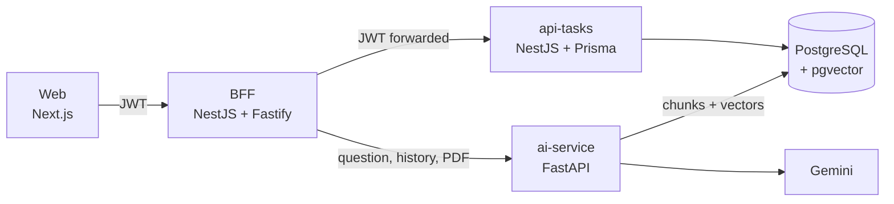

# Vermilion – AI Document Assistant

Upload a PDF and chat with it. Answers stream in real time, come with the pages they were based on, and are generated from your document with **RAG** (Retrieval-Augmented Generation) using **Gemini** and **PostgreSQL + pgvector**.

**Try it:** [web-staging-sbjp.onrender.com](https://web-staging-sbjp.onrender.com/dashboard) – no sign-up needed.
> The staging environment runs on Render's free tier, so the first request after a while of inactivity can take **30–50 seconds** (cold start).


---

## What it does

- **One chat per PDF.** Each uploaded document gets its own chat. Messages are stored, so a chat survives reloads and can be reopened from the sidebar.
- **Answers grounded in the document.** The PDF is split into sentence-aware chunks (with their page), embedded and stored in pgvector. Each question retrieves the closest chunks and the answer shows the pages it used as sources.
- **Questions about the whole document.** Summaries, opinions and ratings ("is this book good?") cannot be answered from five chunks, so the question is classified and, when it is about the document as a whole, the full text is sent (sampled evenly for very long documents).
- **Streaming and Markdown.** Answers appear while they are generated and are rendered as Markdown.
- **Retry and regenerate.** An unanswered question can be retried, and the last answer can be regenerated (the old answer is only removed after the new one is saved).
- **Guest mode without login.** Anyone can try it as a temporary anonymous account, with limits enforced on the server: **1 PDF up to 10 MB, 20 questions, deleted after 24 hours**. Expired guests are removed from the database automatically, and **End session** deletes the data immediately.
- **Robust ingestion.** Uploads are validated, processed in the background (the chat shows *processing / ready / failed* with the reason), and Gemini errors (rate limits, 5xx) are retried.
- **Prompt-injection hardening.** The rules live in the system instruction and the document text is treated as untrusted data, never as instructions.
- **Measured quality.** `services/ai-service/eval/` holds a fixed document and 38 questions (facts, unanswerable, general, injection, off-topic) to check that a change did not make answers worse.

**Current limitations:** only PDFs with selectable text (scanned PDFs need OCR, which is not supported yet), and no TXT/DOCX upload.

---

## Architecture



| Service | Role |
|---|---|
| `apps/web` | Next.js app: chat UI, guest bar, streaming client |
| `apps/bff` | NestJS BFF: orchestrates chats, streams answers, rate-limits guests (no database access) |
| `apps/api-tasks` | NestJS + Prisma: users, guests, chats, messages, limits, cleanup job |
| `services/ai-service` | FastAPI: PDF extraction, chunking, embeddings, retrieval, prompts, generation |

More detail in [`docs/`](docs): [01 – overview](docs/01-visao-geral.md), [02 – chats](docs/02-chats.md), [03 – guest flow](docs/03-guest-flow.md).

---

## Running locally

**Prerequisites:** Docker, and a Gemini API key ([get one](https://aistudio.google.com/apikey)).

```bash
cp services/ai-service/.env.example services/ai-service/.env   # then set GEMINI_API_KEY
docker compose -f docker-compose.dev.yml up --build
```

Open <http://localhost:3000>. The dev compose file mounts the code and runs every service in watch mode (hot reload). After adding a dependency, rebuild with renewed volumes:

```bash
docker compose -f docker-compose.dev.yml up --build -V
```

A production-like stack (no hot reload) is available with `docker compose up --build`.

**Evaluation** (calls Gemini):

```bash
docker exec saas_ai_service python -m eval.run
```

### Configuration

| Service | Variables |
|---|---|
| `ai-service` | `GEMINI_API_KEY`, `DATABASE_URL`; optional `GENERATION_MODEL`, `EMBEDDING_MODEL` (768 dimensions), `RETRIEVAL_TOP_K`, `RETRIEVAL_MAX_DISTANCE`, `GLOBAL_CONTEXT_MAX_CHARS` |
| `api-tasks` | `DATABASE_URL`, `JWT_SECRET`, `APP_URL`, `MAIL_*`; optional `GUEST_CLEANUP_INTERVAL_MS` |
| `bff` | `TASKS_API_URL`, `AI_SERVICE_URL`, `JWT_SECRET` (same as api-tasks), `ALLOWED_ORIGINS` |
| `web` | `NEXT_PUBLIC_BFF_URL` (read at build time) |

---

## Deployment & infrastructure

The staging environment is hosted on **Render**; the database is **Neon** (serverless PostgreSQL with pgvector).

* **Frontend:** [web-staging-sbjp.onrender.com](https://web-staging-sbjp.onrender.com)
* **BFF:** [bff-staging.onrender.com](https://bff-staging.onrender.com)
* **Core API:** [saas-business-manager.onrender.com](https://saas-business-manager.onrender.com)

CI/CD runs on **GitHub Actions**: a push to `staging` applies the Prisma migrations and triggers the Render deploy.

---

## Tech stack

* **Monorepo:** [Turborepo](https://turbo.build/) + [pnpm](https://pnpm.io/) workspaces
* **Web:** [Next.js](https://nextjs.org/) 16, React 19, Tailwind CSS 4, `react-markdown`
* **BFF and API:** [NestJS](https://nestjs.com/) + [Fastify](https://www.fastify.io/), [Prisma](https://www.prisma.io/)
* **AI service:** [FastAPI](https://fastapi.tiangolo.com/), `pypdf`, [Gemini](https://ai.google.dev/) (generation and embeddings)
* **Database:** PostgreSQL with [pgvector](https://github.com/pgvector/pgvector) (cosine distance, HNSW index)
* **Infra:** Docker, GitHub Actions, Render, Neon
