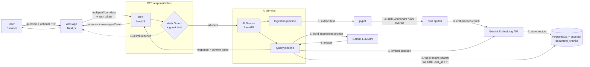

# 01 – AI System Overview

> **Status:** the system is under construction. This document describes what the AI system **will do once finished**. Where the current code already differs from the target design, it is called out in [Current state vs. target](#current-state-vs-target).

## 1. What the system does

The AI system is a **RAG (Retrieval-Augmented Generation) chat assistant** (named *Vermilion*) that lets a user hold a conversation about **a specific file they provide** (e.g. a PDF).

In short:

1. The user uploads a document.
2. The system reads it, splits it into small pieces ("chunks") and stores a numeric representation (embedding) of each piece.
3. When the user asks a question, the system finds the chunks most relevant to that question and hands them to a Large Language Model (LLM) as context.
4. The LLM answers grounded in the user's own document, in the same language as the question.

Rules of the assistant:

- The document context is the primary source of truth for document questions.
- If the answer is not in the document, the assistant says so instead of inventing it.
- When explicitly asked for general or external knowledge, it may answer beyond the document.
- Data is isolated per user: retrieval is always filtered by `user_id`.
- Guest (unauthenticated) users are limited to **10 questions**; registered users are not.

## 2. Big picture

## 3. Data flow, step by step

### 3.1 Ingestion – how a document gets in

| Step | Where | What happens |
|------|-------|--------------|
| 1 | Web → BFF → AI Service | The user uploads a PDF. The BFF forwards it as `multipart/form-data` together with the authenticated `user_id`. |
| 2 | AI Service (`pypdf`) | Text is extracted page by page. If no readable text is found, the request is rejected (400). |
| 3 | AI Service (text splitter) | The text is cut into chunks of **1000 characters with 200 characters of overlap**, so sentences cut at a boundary still appear whole in a neighbouring chunk. |
| 4 | Gemini Embedding API | Each chunk is converted into a **768-dimension vector** that captures its meaning. |
| 5 | PostgreSQL + pgvector | Each chunk is stored in `document_chunks` with `user_id`, `filename`, `content` and `embedding`. An **HNSW index** (cosine distance) keeps similarity search fast. |

### 3.2 Query – how a question gets answered

| Step | Where | What happens |
|------|-------|--------------|
| 1 | Web → BFF | The user sends a question. The BFF validates the token and, for guests, enforces the 10-question limit. |
| 2 | BFF → AI Service | The BFF calls `POST /chat` with `user_id`, `message` and (optionally) a file. |
| 3 | Gemini Embedding API | The question is embedded with the **same model** used for the chunks (required so both live in the same vector space). |
| 4 | PostgreSQL + pgvector | A cosine-distance search (`<=>`) returns the **top 3** closest chunks, restricted to the current user's `user_id`. |
| 5 | AI Service | An **augmented prompt** is assembled: assistant identity and rules + retrieved chunks (the "context") + the user's question. |
| 6 | Gemini LLM API | The model generates the answer from the prompt. |
| 7 | AI Service → BFF → Web | The response is returned with metadata (`context_used`, `filename`); the BFF adds the updated `messagesCount` for guests. |

## 4. Main technologies

| Layer | Technology | Role |
|-------|------------|------|
| Frontend | **Next.js** (`apps/web`) | Chat UI and file upload. |
| Gateway / BFF | **NestJS + Fastify** (`apps/bff`) | Authentication, guest rate limit, multipart handling, proxy to the AI service. |
| AI Service | **FastAPI** + **Uvicorn** (`services/ai-service`) | HTTP API for ingestion and chat; orchestrates the whole RAG pipeline. |
| PDF parsing | **pypdf** | Text extraction from uploaded PDFs. |
| Validation | **Pydantic** | Request/response schemas. |
| LLM | **Google Gemini** via `google-genai` SDK | Answer generation (Flash-Lite class model, optimised for low latency and cost). |
| Embeddings | **Gemini Embedding** (`gemini-embedding-001`, fallback `text-embedding-004`) | Text → 768-dim vectors. |
| Vector store | **PostgreSQL + pgvector** (HNSW, cosine) | Persistent storage and similarity search; hosted on Neon. |
| DB access | **psycopg 3** | Direct SQL from the AI service. |
| Infra | **Docker**, **Turborepo + pnpm**, **GitHub Actions**, **Render** | Packaging, monorepo, CI/CD and hosting. |

> **Note on frameworks:** the system does **not** use PyTorch, Scikit-Learn or LangChain. Models are consumed as managed APIs (Gemini), and the RAG pipeline is implemented directly (chunking, embedding, vector search, prompt building). This keeps the service lightweight and easy to deploy on small instances.

## 5. Why this design

- **RAG instead of fine-tuning:** the model never needs retraining; answers always reflect the document the user just provided.
- **BFF in front of the AI service:** the AI service is never exposed directly to the browser, and auth/limits live in one place.
- **Separate AI service (Python):** keeps AI concerns isolated from the business API and lets it scale or be replaced independently.
- **pgvector inside PostgreSQL:** one database for relational and vector data, no extra infrastructure.
- **Per-user filtering at query time:** one user can never retrieve another user's chunks.

## 6. Current state vs. target

| Area | Current code | Target |
|------|--------------|--------|
| Ingestion | Done for logged-in users: uploading a PDF in the sidebar ingests it through the BFF (see [02-chats.md](02-chats.md)). | Same. |
| Chat with file | Logged-in chats use only the stored chunks. The guest chat still uploads the file to Gemini on each request. | Use only stored chunks for guests too. |
| Scope of retrieval | Logged-in chats search only the chat's document. The guest flow still searches by `user_id`. | Same. |
| Chunking | Fixed character windows. | Possibly sentence/paragraph-aware splitting. |
| Conversation memory | Logged-in chats send the last 10 messages as history. The guest chat is stateless. | Same. |
| Document types | PDF only. | Additional formats (e.g. DOCX, TXT). |

The detailed documents that follow (`02-…` onward) will cover each stage of the pipeline in depth.
