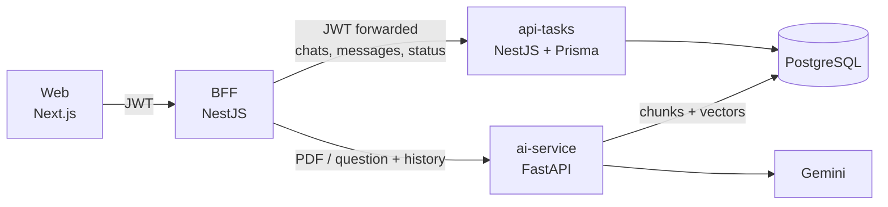
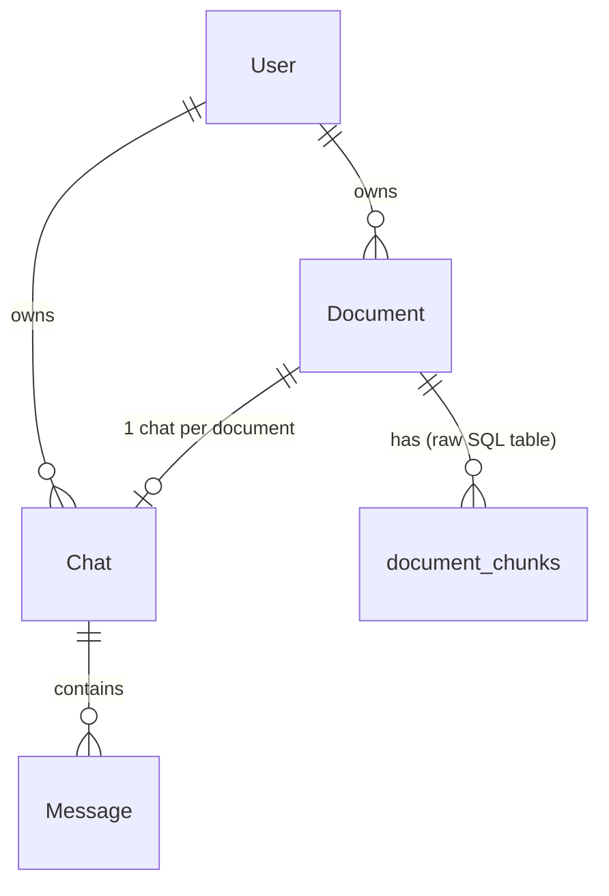

# 02 – Per-Document Chats (Logged-in Area)

This document explains how the logged-in area works: each user has several chats, and **each chat is tied to exactly one uploaded PDF**. It builds on the pipeline described in [01-visao-geral.md](01-visao-geral.md).

## 1. Behaviour

- A logged-in user uploads a PDF with **New Chat (PDF)**. This creates a document, a chat and the embeddings for the file.
- Every question in that chat is answered using **only that document's chunks**, plus the last 10 messages of the conversation.
- Messages are stored, so a chat survives page reloads and can be reopened from the sidebar.
- Deleting a chat deletes its document, its messages and its vector chunks.
- Users only ever see their own chats.
- Guests (no login) keep the old single, temporary chat with the 10-question limit. They cannot open `/dashboard/<chatId>` (it redirects to `/login`).

## 2. Architecture



| Service | Responsibility for chats |
|---------|--------------------------|
| **api-tasks** | Owns the data (`Document`, `Chat`, `Message`). Verifies the JWT itself and filters every query by the user in the token. |
| **BFF** | Orchestrates: calls api-tasks for data and ai-service for embeddings/answers. It only accepts a valid JWT on `/chats` (guests are rejected) and forwards the same `Authorization` header to api-tasks. |
| **ai-service** | Stateless AI work: PDF → chunks → embeddings, and retrieval + answer generation. It stores chunks but knows nothing about chats or messages. |

The BFF has no database of its own, which is why it orchestrates instead of storing anything.

## 3. Data model

Defined in `apps/api-tasks/prisma/schema.prisma`; migration `20260803120000_add_documents_chats_messages`.



| Table | Key fields | Notes |
|-------|-----------|-------|
| `Document` | `userId`, `filename`, `status` (`PROCESSING`, `READY`, `FAILED`), `failureReason` | Created as `PROCESSING`; ends `READY`, or `FAILED` with the reason shown to the user. |
| `Chat` | `userId`, `documentId` (**unique**), `title`, `updatedAt` | The unique `documentId` enforces one chat per file. `title` defaults to the filename. `updatedAt` orders the sidebar. |
| `Message` | `chatId`, `role` (`USER`, `AI`), `content`, `createdAt` | Indexed by `(chatId, createdAt)` for ordered history. |
| `document_chunks` | `document_id`, `user_id`, `filename`, `content`, `embedding vector(768)` | Created by raw SQL, not managed by Prisma. `document_id` is a foreign key to `Document` with `ON DELETE CASCADE`. |

All relations cascade on delete, so removing a `Document` removes its `Chat`, `Message`s and chunks in one statement.

`document_chunks.document_id` is nullable on purpose: legacy rows have no document, and the guest flow still searches by `user_id`.

## 4. Flows

### 4.1 Creating a chat (upload)

`POST /chats` (BFF, multipart: `filename` + `file`). The request returns **immediately**; embedding happens in the background.

1. The BFF checks the file: the name must end in `.pdf` **and** the content must contain the `%PDF-` signature near the start. Otherwise 400.
2. api-tasks `POST /chats` creates the `Document` (`PROCESSING`) and the `Chat`. The chat is returned to the UI right away, which opens it.
3. In the background, the BFF calls ai-service `POST /rag/process-pdf` with `user_id`, `document_id` and the file.
4. ai-service validates the PDF again, extracts the text, splits it (1000 chars, 200 overlap), embeds **all chunks first** (in batches), and only then inserts them in one transaction, so a failure never leaves half a document.
5. The BFF sets the document `READY`, or `FAILED` with the reason returned by ai-service.

The UI polls every 3 seconds while a document is `PROCESSING` (sidebar badge, banner in the chat, input disabled). Asking a question before the document is `READY` returns **409**.

Failures that end in `FAILED` with a readable reason: not a valid PDF, corrupted or password-protected PDF, no extractable text (scanned PDF), embedding API errors. A failed chat is kept so the user can read the reason, and can be deleted from the sidebar.

If the BFF restarts during ingestion the document would stay `PROCESSING` forever, so api-tasks marks any document still `PROCESSING` after 15 minutes as `FAILED` whenever chats are listed or opened.

#### Embedding batches, retries and the free-tier quota
- Chunks are embedded up to 100 per API call (the API maximum) instead of one call per chunk.
- Rate-limit (429) and server errors (500, 502, 503, 504) are retried up to 5 times. For a 429 the wait follows the "retry in Ns" hint returned by the API; other errors back off 2, 4, 8... seconds. Other errors (e.g. 400) fail immediately.
- On the Gemini **free tier every text in a batch counts toward a limit of 100 embedding requests per minute**. A document with more than about 100 chunks (roughly a 30-page PDF) therefore pauses between batches until the quota window resets; measured: 230 chunks took about 86 s. A paid tier removes this wait.
- `/rag/process-pdf` is a plain `def` endpoint, so FastAPI runs it in a worker thread and a long ingestion does not block `/chat` or `/health`.
- There is a single embedding model. The old fallback to `text-embedding-004` was removed because mixing models would put vectors from different spaces in the same table and silently degrade search.

### 4.2 Asking a question

`POST /chats/:id/messages` (BFF, JSON `{ content }`)

1. Load the chat from api-tasks (ownership check; gives the `documentId` and the document status).
2. Load the previous messages and keep the last 10 as history.
3. Save the user message.
4. Call ai-service `POST /chat` with `user_id`, `document_id`, `message` and `history` (JSON).
5. ai-service embeds the question and runs a cosine search restricted to `WHERE document_id = ? AND user_id = ?` (top 3), then builds the prompt: identity and rules + chunks + previous messages + question.
6. Save the AI answer and return both messages.

The BFF refuses (409) when the document is not `READY`.

The history is read **before** saving the new question, so the question is not duplicated in the prompt. If the AI call fails, the user message stays saved and the BFF returns 502; the UI reloads the messages so it matches the server.

## 5. API reference

### BFF (all require `Authorization: Bearer <jwt>`; guests get 401)

| Method | Route | Description |
|--------|-------|-------------|
| `GET` | `/chats` | The user's chats, most recently updated first. |
| `POST` | `/chats` | Upload a PDF (`multipart/form-data`: `file`, `filename`). Returns the new chat at once with `document.status = PROCESSING`. 400 if the file is not a valid PDF. |
| `GET` | `/chats/:id` | One chat with its document. |
| `DELETE` | `/chats/:id` | Delete the chat, its document, messages and chunks. |
| `GET` | `/chats/:id/messages` | Messages in chronological order. |
| `POST` | `/chats/:id/messages` | Body `{ "content": "..." }`. Returns `{ userMessage, aiMessage }`. 409 while the document is not `READY`. |

A chat that does not exist **or belongs to someone else** returns 404 in every route, so ids cannot be probed.

### api-tasks (internal; same routes plus `PATCH /chats/:id/document` with `{ status, failureReason? }`)

The user id always comes from the verified token (`sub`), never from the request body.

### ai-service

| Route | Changes for chats |
|-------|-------------------|
| `POST /rag/process-pdf` | New optional form field `document_id`, stored with each chunk. Validates the PDF content, embeds in batches with retries, saves in one transaction. Errors are returned as `detail` (400 for user-fixable problems). |
| `POST /chat` | New optional fields `document_id` (restrict retrieval to that document) and `history` (JSON list of `{role, content}`). Without `document_id` the legacy guest behaviour is unchanged. |

## 6. Frontend

All in `apps/web`.

| File | Role |
|------|------|
| `lib/chats.ts` | Types and API calls (`listChats`, `createChatFromFile`, `sendMessage`, ...). |
| `components/ChatsProvider.tsx` | Context with auth state (`loading`, `guest`, `user`), the chat list, `refreshChats`, `logout`. Polls the list while any document is `PROCESSING`. A 401 clears the token and sends the user to `/login`. |
| `components/ChatSidebar.tsx` | Chat list with `Processing…` / `Failed` badges, **New Chat (PDF)** (PDF only), delete, logout. Mobile drawer. |
| `app/(dashboard)/dashboard/layout.tsx` | Wraps the area. Guests get the page as-is; logged-in users get the sidebar. |
| `app/(dashboard)/dashboard/page.tsx` | Empty state for logged-in users; `GuestChat` for guests. |
| `app/(dashboard)/dashboard/[chatId]/page.tsx` | Loads the chat and its messages, polls while processing, shows the processing/failed banner and disables the input until `READY`, sends questions (optimistic user message), redirects guests to `/login`. |
| `components/GuestChat.tsx` | The previous single chat, moved unchanged. |

The token is kept in `localStorage`, as it was before.

## 7. Security notes

- Every api-tasks query filters by the user from the JWT; ai-service retrieval filters by both `document_id` and `user_id`.
- The BFF's `JwtAuthGuard` is strict (no guest fallback); the older `AuthGuard` is still used by the guest `/chat`.
- The BFF limits uploads to 20 MB and checks both the `.pdf` name and the `%PDF-` signature (ai-service checks again).
- `JWT_SECRET` should be set for real in every service. Today the guards fall back to `seu_secret_aqui`, and the BFF's `JwtModule` registration falls back to a different string (`sua_chave_secreta_aqui`). Nothing breaks, because verification passes the secret explicitly, but the fallbacks should be removed.

## 8. Known limitations

- Background ingestion runs inside the BFF process and keeps the file in memory; it is not a durable queue. A restart loses the job (the document is marked `FAILED` after 15 minutes).
- On the Gemini free tier, documents with more than ~100 chunks wait on the per-minute embedding quota (see section 4.1).
- PDFs without extractable text (scans) are rejected with a clear message; there is no OCR.
- Only PDF is supported (no TXT or DOCX yet).
- The filename travels in a separate `filename` form field because the BFF's multipart plugin (`attachFieldsToBody: 'keyValues'`) drops it from the file part.
- Only the last 10 messages are sent as history, and only 3 chunks are retrieved per question.
- The legacy guest chat still uploads the whole file to Gemini on each question.
- `prisma migrate dev` may report drift on `document_chunks`, since Prisma does not manage that table. `migrate deploy` is unaffected.

## 9. Running and trying it

```bash
docker compose up -d --build
```

Then open http://localhost:3000, register, log in and click **New Chat (PDF)**. `services/ai-service/.env` needs a valid `GEMINI_API_KEY` (see `.env.example`).
